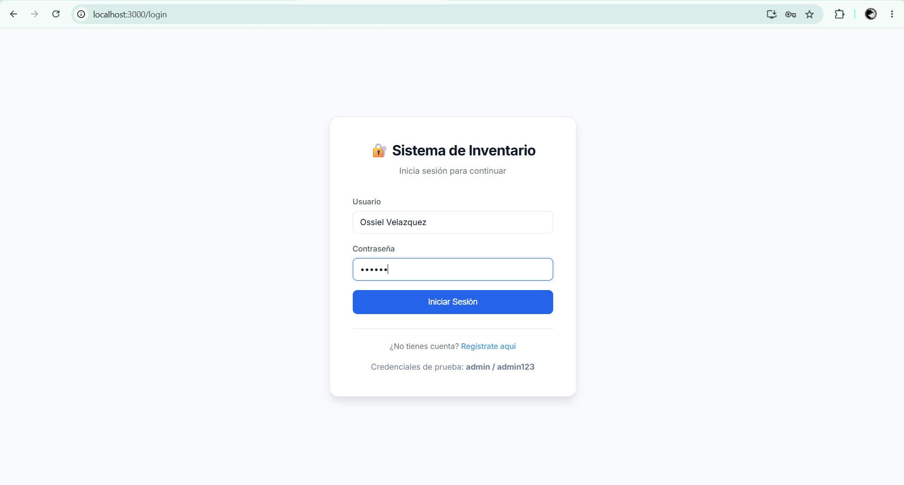
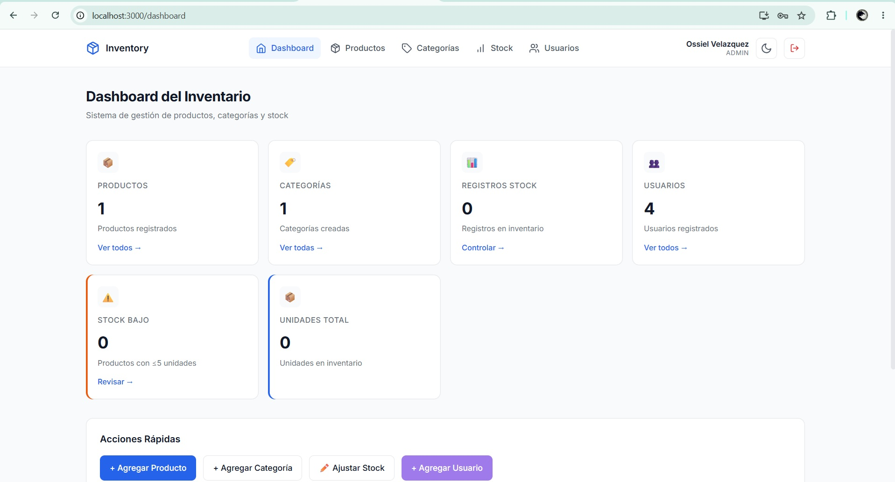
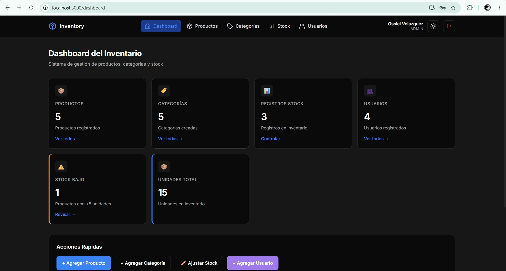
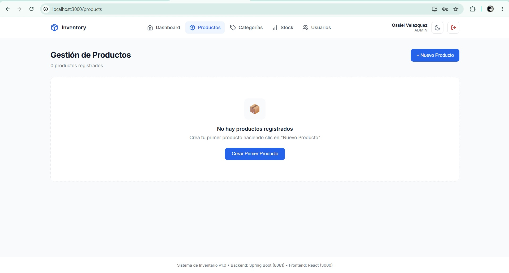
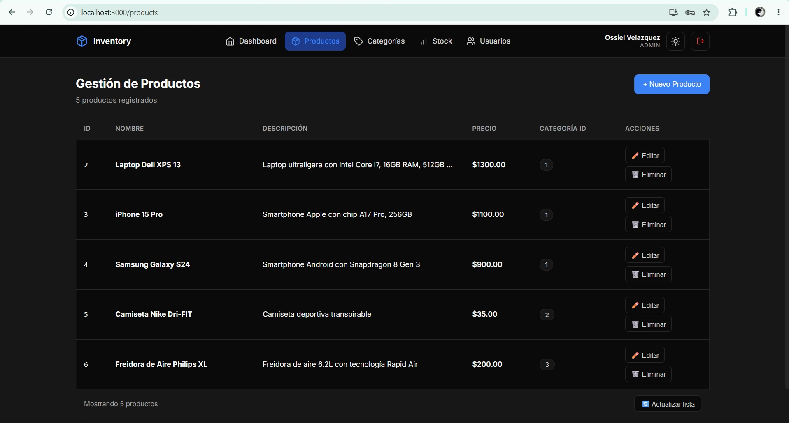
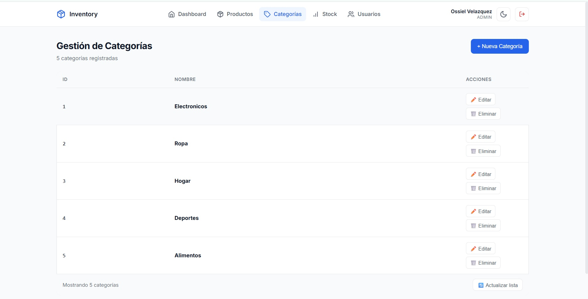
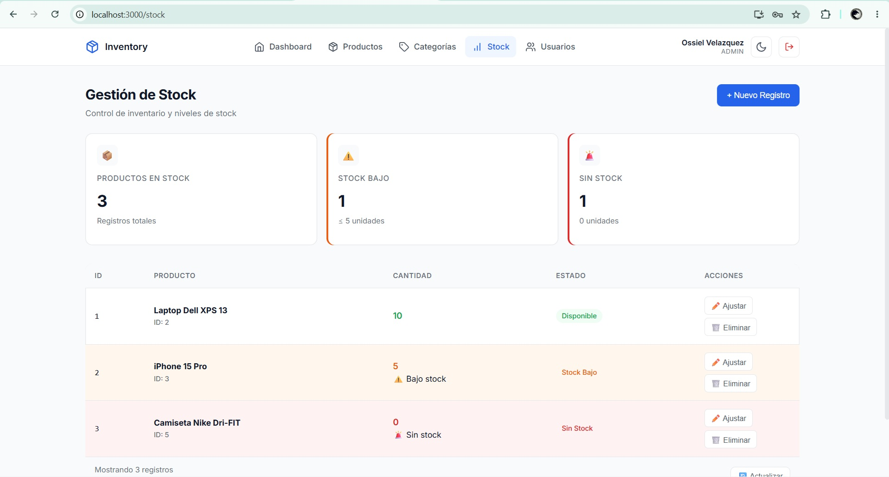

# 📦 Inventory System - Full Stack

Full stack inventory management system with JWT authentication and role-based access control.


## 🚀 Stack

**Backend**
- Java 23
- Spring Boot 3.5
- Spring Security + JWT
- PostgreSQL 17
- Hibernate / JPA
- Swagger / OpenAPI

**Frontend**
- React 18
- React Router 6
- Axios

**DevOps**
- Docker & Docker Compose

## ✨ Features

- JWT authentication
- Role-based access control (ADMIN, MANAGER, USER)
- Product, category and stock management
- User management (admin only)
- Dashboard with inventory statistics
- Low stock alerts
- REST API documented with Swagger
- Integration tests with JUnit 5 + MockMvc
- Fully dockerized

## 📸 Screenshots

### Login


### Dashboard


### Dashboard - Dark Mode


### Products


### Products - Dark Mode


### Categories


### Stock Management


## 🎯 Roles & Permissions

| Action | USER | MANAGER | ADMIN |
|--------|:----:|:-------:|:-----:|
| View products/categories/stock | ✅ | ✅ | ✅ |
| Create/edit products | ❌ | ✅ | ✅ |
| Delete products | ❌ | ❌ | ✅ |
| Manage users | ❌ | ❌ | ✅ |

## 🐳 Quick Start with Docker

The easiest way to run the entire application:

```bash
git clone https://github.com/OssielVelazquez/inventory-system.git
cd inventory-system
docker-compose up --build
```

Then open:

- **Frontend**: http://localhost:3000
- **Backend API**: http://localhost:8081
- **Swagger UI**: http://localhost:8081/swagger-ui.html

That's it! Everything (PostgreSQL + backend + frontend) runs in containers.

### Useful Docker commands

```bash
# Run in background
docker-compose up -d --build

# View logs
docker-compose logs -f

# Stop everything
docker-compose down

# Stop and delete database data
docker-compose down -v
```

## 🔧 Manual Setup

If you prefer to run without Docker:

### Requirements

- Java 23+
- Node.js 18+
- PostgreSQL 14+

### Backend

```bash
cd inventory-api

# Configure database credentials in src/main/resources/application.yaml
# Or set environment variables: DB_URL, DB_USER, DB_PASSWORD, JWT_SECRET

mvn spring-boot:run
```

Backend runs on `http://localhost:8081`

### Frontend

```bash
cd inventory-frontend

# Copy environment variables
cp .env.example .env

npm install
npm start
```

Frontend runs on `http://localhost:3000`

## 🧪 Running Tests

```bash
cd inventory-api
mvn test
```

The project includes 14 integration tests covering:

- `AuthControllerTest` — login, register, JWT flow, role assignment
- `ProductControllerTest` — CRUD operations, authorization rules

## 📚 API Documentation

Once running, access Swagger UI at:

```
http://localhost:8081/swagger-ui.html
```

You can test all endpoints directly from the browser.

## 🔑 Demo Credentials

| Username | Password | Role |
|----------|----------|------|
| admin | admin123 | ADMIN |
| manager | manager123 | MANAGER |
| user | user123 | USER |

## 📁 Project Structure

```
inventory-system/
├── docker-compose.yml            # Orchestrates all services
│
├── inventory-api/                # Spring Boot backend
│   ├── Dockerfile
│   └── src/main/java/com/kyoran/inventory_api/
│       ├── config/               # Security, CORS, OpenAPI
│       ├── controller/           # REST endpoints
│       ├── dto/                  # Data Transfer Objects
│       ├── entity/               # JPA entities
│       ├── repository/           # Spring Data repositories
│       └── security/             # JWT & UserDetailsService
│
└── inventory-frontend/           # React frontend
    ├── Dockerfile
    ├── nginx.conf                # Nginx config with API proxy
    └── src/
        ├── components/           # Reusable components
        ├── pages/                # Views
        └── services/             # API services
```

## 📡 API Endpoints

### Authentication

| Method | Endpoint | Description |
|--------|----------|-------------|
| POST | `/api/auth/login` | User login |
| POST | `/api/auth/register` | User registration |
| GET | `/api/auth/me` | Get current user |

### Resources (JWT required)

| Method | Endpoint | Roles |
|--------|----------|-------|
| GET | `/products` | Any authenticated |
| POST/PUT | `/products` | ADMIN, MANAGER |
| DELETE | `/products` | ADMIN |
| GET | `/categories` | Any authenticated |
| POST/PUT | `/categories` | ADMIN, MANAGER |
| DELETE | `/categories` | ADMIN |
| GET | `/stock` | Any authenticated |
| POST/PUT | `/stock` | ADMIN, MANAGER |
| DELETE | `/stock` | ADMIN |
| GET | `/users` | ADMIN |
| POST/PUT/DELETE | `/users` | ADMIN |

## 🚧 Roadmap

- [x] JWT authentication
- [x] Role-based access control
- [x] Full CRUD (products, categories, stock, users)
- [x] Swagger / OpenAPI documentation
- [x] JPA relationships
- [x] Integration tests
- [x] Docker support
- [ ] UI/UX redesign
- [ ] Deploy to cloud
- [ ] CI/CD with GitHub Actions

## 👤 Author

**Ossiel Velázquez**
- GitHub: [@OssielVelazquez](https://github.com/OssielVelazquez)

## 📄 License

This project is open source and available for educational purposes.
